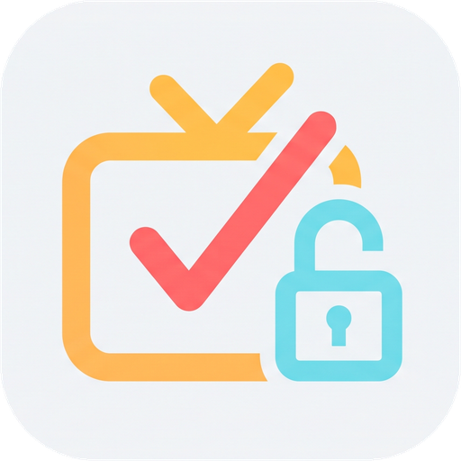
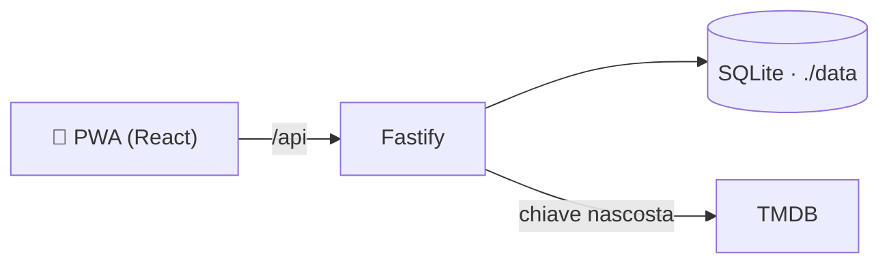

<div align="center">
  
  <h1>Series Tracker</h1>
  <p><strong>Track your shows, keep your freedom.</strong></p>
  <p>La tua lista, i prossimi episodi e le statistiche — con il tuo server, i tuoi dati.</p>
  <p>
    
    
    
    
  </p>
</div>

---

Series Tracker è una web app **mobile-first** per organizzare le serie che guardi. Installala come app sul telefono o sul desktop e sincronizza la tua libreria con un server che gestisci tu.

## ✨ Cosa puoi fare

| | |
|---|---|
| 📺 **La tua libreria** | Organizza le serie in corso, da vedere, completate e abbandonate. |
| ⏭️ **Prossimi episodi** | Scopri cosa guardare e segna gli episodi con un tocco. |
| 🔎 **Cerca e scopri** | Cerca per titolo, filtra per genere, anno e voto, o ricevi consigli personalizzati. |
| ⭐ **Voti e statistiche** | Dai un voto alle serie e scopri generi e serie più seguiti e il tempo di visione stimato. |
| 🎨 **Il tuo stile** | Scegli tema chiaro, scuro o automatico e personalizza il colore d'accento. |
| ☁️ **Self-hosted** | Account multiutente e libreria sincronizzata nel tuo database SQLite. |
| 📲 **PWA** | Installabile su smartphone e desktop; interfaccia pensata prima per mobile. |

## 🚀 Avvio rapido con Docker Compose

### 1. Crea una chiave API TMDB

Series Tracker usa [The Movie Database (TMDB)](https://www.themoviedb.org/) per i dati delle serie, gli episodi e i poster.

1. [Crea un account TMDB](https://www.themoviedb.org/signup) e verifica l'email.
2. Accedi e apri [Impostazioni → API](https://www.themoviedb.org/settings/api).
3. Registra un'applicazione per uso **Developer**, se richiesto.
4. Copia il **Read Access Token** (consigliato) oppure la **API Key (v3)**.

Entrambi i formati sono supportati. La chiave è utilizzata dal backend, **mai esposta al browser**: custodiscila come una password. Per approfondire, consulta la [documentazione TMDB](https://developer.themoviedb.org/docs).

### 2. Configura il server

Clona il repository e crea la configurazione locale:

```powershell
git clone https://github.com/rubinog/seriesTracker.git
cd seriesTracker
Copy-Item .env.example .env
```

Apri `.env` e inserisci la chiave:

```dotenv
TMDB_API_KEY=incolla_qui_la_tua_chiave
ALLOW_SIGNUP=true
```

`.env` contiene segreti e viene escluso da Git. **Non condividerlo e non inserirlo nel repository.**

### 3. Avvia l'app

```powershell
docker compose up -d --build
```

Apri [http://localhost:3000](http://localhost:3000) e crea il tuo account. Fatto! 🎉

Comandi utili:

```powershell
docker compose logs -f       # segui i log
docker compose down          # ferma l'app, conserva i dati
docker compose up -d --build # ricostruisci dopo un aggiornamento
```

<details>
<summary><strong>Preferisci non compilare? Usa l'immagine già pronta</strong></summary>

In `docker-compose.yml` sostituisci la sezione `build` con

```yaml
image: ilrubio/seriestracker:latest
```

Mantieni il resto del servizio (`.env` e il volume `./data:/data`) e aggiorna con `docker compose pull` seguito da `docker compose up -d`. Per fissare una versione usa, al posto di `latest`, il tag con l'abbreviazione del commit.

</details>

### ⚙️ Configurazione

| Variabile | Default | Descrizione |
|---|---|---|
| `TMDB_API_KEY` | — | **Obbligatoria.** Read Access Token o API Key v3 di TMDB. |
| `ALLOW_SIGNUP` | `true` | Se `false`, chiude le nuove registrazioni. |
| `TRUST_PROXY` | `false` | Imposta `true` dietro un reverse proxy, così il limite di tentativi di login usa l'IP reale. |
| `PORT` | `3000` | Porta del server. |
| `DATA_DIR` | `/data` | Cartella di database SQLite e segreto JWT. |
| `JWT_SECRET` | generato | Segreto di firma dei token (altrimenti creato in `DATA_DIR`). |
| `APP_VERSION` | `dev` | Versione mostrata in **Altro**. |

Il login è protetto da un limite di tentativi: dopo 10 errori in 15 minuti per utente e IP, l'accesso viene bloccato temporaneamente.

### 🏗️ Come funziona



La chiave TMDB resta sul server: il browser parla solo con la tua istanza.

### Aggiornamenti e versione

La versione mostrata in **Altro** corrisponde all'abbreviazione del commit che ha generato la build. In sviluppo viene rilevata automaticamente da Git. Per creare un container con la versione corretta, dalla cartella del repository esegui:

```powershell
$env:APP_VERSION = (git rev-parse --short HEAD)
docker compose up -d --build
Remove-Item Env:APP_VERSION
```

Se non imposti `APP_VERSION`, la build Docker mostra `dev`.

## 🔒 Pubblicazione sicura

Docker Compose espone l'app sulla porta `3000`. Per raggiungerla da altri dispositivi o da Internet, mettila dietro un reverse proxy come Caddy, Traefik o nginx e abilita **HTTPS**: è necessario per installare la PWA e protegge le credenziali. Evita di esporre il container direttamente su Internet senza TLS.

Dopo aver creato gli account desiderati, puoi chiudere le nuove registrazioni impostando in `.env`:

```dotenv
ALLOW_SIGNUP=false
```

Applica la modifica con `docker compose up -d`.

Il container parte come root solo per sistemare i permessi di `./data`, poi esegue l'app come utente non privilegiato (`node`). Il `HEALTHCHECK` integrato permette a Docker di segnalare se il servizio non risponde.

### Password o nome utente dimenticati

Non c'è il recupero via email: da amministratore puoi consultare gli utenti e reimpostare una password direttamente sul server.

```powershell
docker compose exec -u node seriestracker node list-users.mjs
docker compose exec -u node seriestracker node reset-password.mjs <utente> <nuova-password>
```

In sviluppo locale, dalla cartella `server`: `node reset-password.mjs <utente> <nuova-password>`. La nuova password deve avere almeno 8 caratteri. Se usi l'immagine di Docker Hub, serve una versione che includa lo script (aggiorna con `docker compose pull`).

### Dati e backup

Puoi scaricare e reimportare le tue serie, i voti e gli episodi visti da **Altro → Backup** (file JSON).

Database SQLite e segreto di firma dei token sono conservati in `./data`, montata nel container. Per creare un backup completo del server:

```powershell
docker compose down
Copy-Item -Recurse data data-backup
docker compose up -d
```

Proteggi il backup: contiene i dati degli account. **Non eliminare `data`** durante gli aggiornamenti.

## 🧑‍💻 Sviluppo locale

Richiede **Node.js 24 o superiore** (`node:sqlite`). Apri due terminali PowerShell nella cartella del repository.

**Terminale 1 — backend**

```powershell
cd server
npm ci
$env:TMDB_API_KEY = "la_tua_chiave"
node --disable-warning=ExperimentalWarning index.mjs
```

**Terminale 2 — frontend**

```powershell
cd web
npm ci
npm run dev -- --host
```

Apri l'indirizzo mostrato da Vite (di solito [http://localhost:5173](http://localhost:5173)). Vite inoltra `/api` al server locale su `localhost:3000`.

Controlli frontend:

```powershell
cd web
npm run build
npm run lint
```

## 🧰 Tecnologie

**React · TypeScript · Vite · Tailwind CSS · PWA · Fastify · Node.js 24 · SQLite · Docker Compose · TMDB API**

## 📄 Licenza

Distribuito con licenza [AGPL-3.0](LICENSE): libero di usarlo, modificarlo e condividerlo, a patto che le versioni modificate (anche se offerte come servizio online) restino open source con la stessa licenza.

## 🎬 Attribuzione

Questo prodotto utilizza l'API TMDB, ma non è approvato né certificato da TMDB. Serie, immagini e metadati sono forniti da TMDB; consulta i [termini d'uso](https://www.themoviedb.org/documentation/api/terms-of-use) e le relative linee guida.
